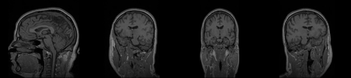

# Matala 1: cutting a 3D volume along a plane

Exercise 1 of Introduction to Software Engineering (Ariel University).

The program takes a 3D volume (an MRI scan in NRRD format) and a list of planes, and makes a video with the cut of the volume along each plane: one frame per plane, in the order of the list.

A plane is given by 3 points (an isosceles triangle) or 4 points (an isosceles trapezoid). The cut follows the professor's algorithm: two points go down the two sides of the shape, and each row of the image is read between them.



## Scope

In scope: reading a NRRD volume, checking the shapes, computing the cuts, writing the MP4 video, measuring the speed.

Out of scope: a graphical interface, 3D display, editing the volume, medical analysis, other file formats.

## Quick start

Python 3.10 or newer.

```powershell
python -m pip install -r requirements.txt
python Ex0.py MRHead_1.nrrd planes_100.csv demo.mp4
```

`MRHead_1.nrrd` is not in the repository (see [docs/DATASET.md](docs/DATASET.md) for the download link).

Other commands:

```powershell
python make_planes.py MRHead_1.nrrd my_planes.csv --mode random --count 100   # make a CSV of planes
python -m pytest                                                              # run the tests
python benchmark.py                                                           # cuts per second on 500^3
```

## CSV format

One plane per row, the same header as the professor's example:

```
Number of Points (3 or 4),x1,y1,z1,x2,y2,z2,x3,y3,z3,x4,y4,z4
3,128,40,40,53,140,40,203,100,120,,,
4,100,60,30,156,60,30,70,180,90,186,180,90
```

Coordinates are voxel indices (not millimeters). With 3 points the order is `a, b, c` with `dist(a,b) = dist(a,c)`. With 4 points it is `a1, a2, b, c`: the small base `a1 a2`, the big base `b c`, and the sides `a1 -> b` and `a2 -> c`.

## Files

| File | What it does |
|---|---|
| `Ex0.py` | the demo: NRRD + CSV -> MP4 |
| `slicing.py` | the checks and the cut (the algorithm) |
| `make_planes.py` | makes CSV files of planes for a volume |
| `benchmark.py` | measures the cuts per second |
| `main.py` | first version of the demo: saves the cut of the first CSV row as a PNG |
| `tests/` | the tests, and `slow_slicing.py`, the first loop version kept as a reference |
| `demo/` | the videos of the experiment |

## Documents

- [SRS.md](SRS.md): what the program must do
- [docs/DESIGN.md](docs/DESIGN.md): the algorithm in detail and the choices we made
- [docs/DATASET.md](docs/DATASET.md): the volumes and the CSV files
- [docs/TESTING.md](docs/TESTING.md): the tests and how to run them
- [docs/EXPERIMENT.md](docs/EXPERIMENT.md): results, speed, videos

## Use of AI

As allowed by the course, I used an AI assistant (Claude, by Anthropic). The first version of `slicing.py` and `main.py` is mine, written from the professor's pseudo-code. Claude helped me find bugs, add the trapezoid, the video output, the plane generator, the tests, the fast NumPy version and these documents.
