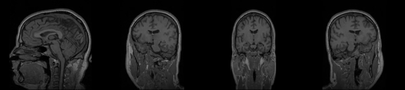
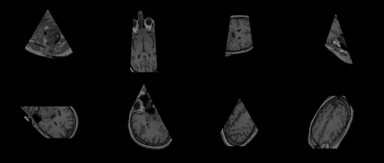

# Experiment

## What we ran

```powershell
python Ex0.py MRHead_1.nrrd planes_100.csv demo/planes_100.mp4
python Ex0.py MRHead_1.nrrd random_100.csv demo/random_100.mp4
python benchmark.py
```

Computer: Intel Xeon 2.8 GHz, 2 cores, Linux, Python 3.13, NumPy 2.5 (a cloud machine, not my PC). The numbers changed by about 10% from one run to the next; the tables give the range of 2 or 3 runs.

## The videos

[`demo/planes_100.mp4`](../demo/planes_100.mp4): 100 squares turning half a turn around the vertical axis of the head. The head is seen from the side, then from the front, then from the other side.



[`demo/random_100.mp4`](../demo/random_100.mp4): 100 random triangles and trapezoids, in all directions. 92 of them have points outside the volume: these parts are black.



What we see:

- The anatomy is in the right place and continuous from one frame to the next in the turning video, so the planes are followed in the CSV order.
- The images are rather dark: the gray scale goes up to the brightest voxel of the volume (279), while almost all voxels are under 153. This keeps the same gray for the same value in every frame (see DESIGN.md, section 7).
- The triangles of `random_100.mp4` look a little stretched vertically. This is the algorithm: each row moves by 1 along the side, not straight down (DESIGN.md, section 5).
- `professor_example.csv` stops at row 4: rows 4 and 5 are not valid shapes (DATASET.md).

## Speed

Only the cuts are measured, not the reading of the files or the writing of the video.

### On a 500³ volume of bytes (the requirement)

`benchmark.py`, 200 cuts per test:

| Planes | Image size | Cuts per second |
|---|---|---|
| Squares through the whole volume, turning (worst case) | about 500 × 710 pixels | 61 to 66 |
| Random triangles and trapezoids | 135 000 pixels on average | 220 to 233 |

The requirement is at least 30 cuts per second (100 if possible). The worst case is 2 times over the minimum, the random planes are over 100.

### On MRHead

Printed by `Ex0.py`:

| CSV | Cuts per second |
|---|---|
| `planes_100.csv` | 255 to 358 |
| `random_100.csv` | 490 to 565 |

### Before and after

| Version | MRHead, `planes_100.csv` |
|---|---|
| First version, one pixel at a time (`tests/slow_slicing.py`) | about 1 cut per second (100 cuts in 87 s) |
| NumPy version (`slicing.py`) | 255 to 358 cuts per second |

Both versions give exactly the same images (`tests/test_fast_matches_slow.py`).

Most of the time of a cut is now spent on computing the positions of the points and reading the voxels, about 3 to 6 ms each for the biggest cut. The professor said that there is no need to go much over 100, so we stopped here.

## What we learned

- The first version was correct but 30 times too slow. The same steps on whole arrays were enough, without changing the algorithm.
- Keeping the slow version as a reference made the fast version safe to write: every difference shows in the tests.
- Random planes and the sphere test found two rounding bugs that hand-made examples did not show (DESIGN.md, section 5).
